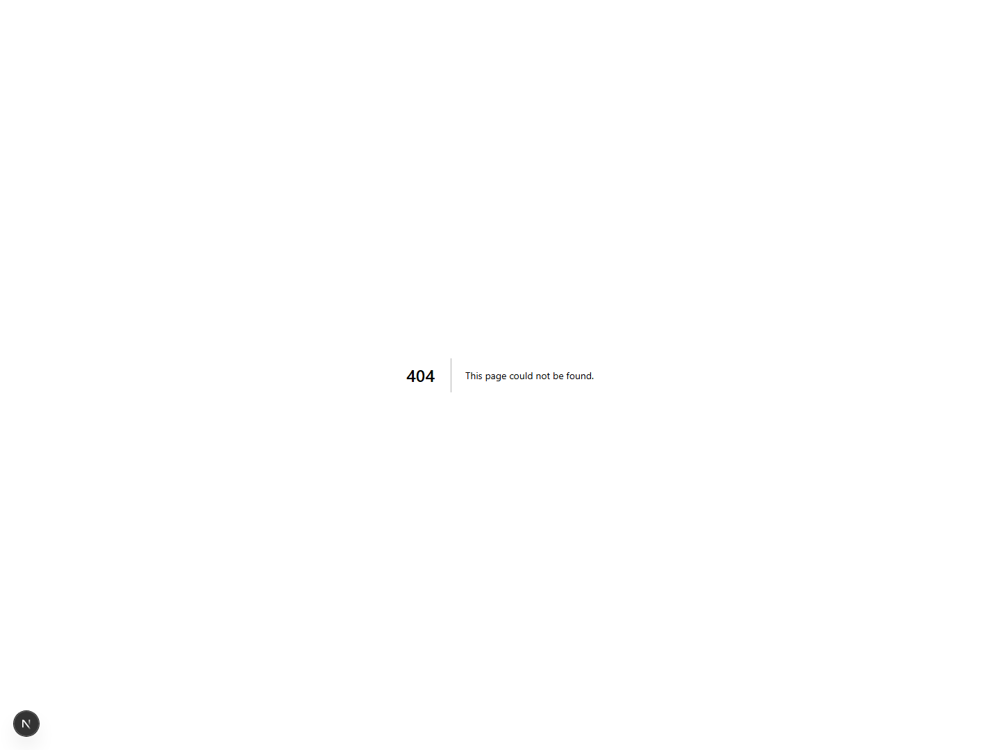
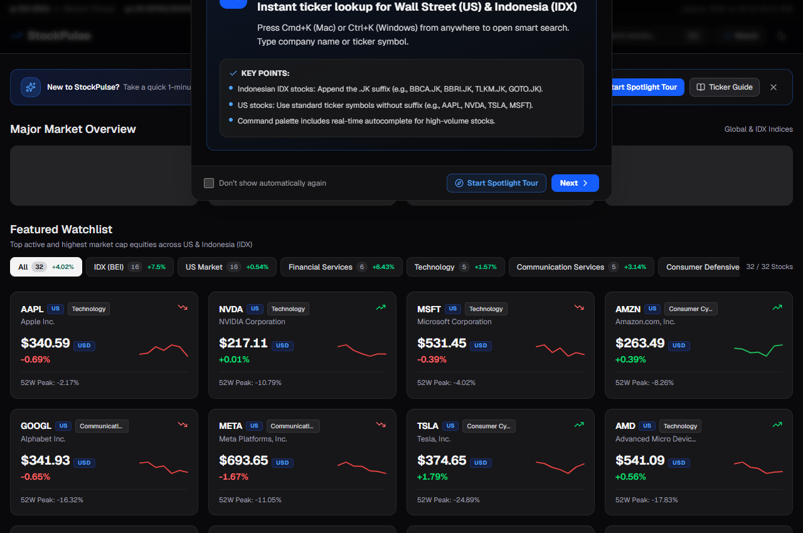

# 📈 StockPulse — Real-Time Stock Market Watcher

<div align="center">

🌐 **Bahasa / Language:** **Bahasa Indonesia** | [English](./README.md)

</div>

> **StockPulse** adalah platform analitik dan pemantau pasar saham real-time untuk bursa Amerika Serikat (US) dan Indonesia (IDX / BEI). Dibangun dengan arsitektur modern berdensitas tinggi, stack serverless gratis (*100% free tier*), charting kanvas sekelas TradingView, analitik meja teknikal institusional (*Institutional Technical Desk*), serta kalkulator mekanika bursa BEI.

---

[-black?logo=next.js)](https://nextjs.org)
[](https://react.dev)
[](https://fastapi.tiangolo.com)
[](https://tailwindcss.com)
[](https://www.typescriptlang.org)
[](https://tradingview.github.io/lightweight-charts/)
[-green?logo=vitest)](https://vitest.dev)
[-green?logo=pytest)](https://pytest.org)
[](https://supabase.com)
[](https://stock-market-watcher-lemon.vercel.app)
[-brightgreen?logo=vercel&logoColor=white)](https://stock-market-watcher-lemon.vercel.app)
[](#-ai-assisted-development)

---

## 📸 Bukti Tampilan Terbaru & Fitur Unggulan

Berikut adalah bukti tangkapan layar langsung (*live screenshot captures*) dari antarmuka StockPulse terbaru:

### 1. 🌟 Interactive Spotlight Tour (Langkah 1 & 2)
Panduan interaktif visual langsung di atas elemen DOM aktif via React Portal, dilengkapi *true cutout spotlight* (`boxShadow: 0 0 0 9999px rgba(0,0,0,0.75)` dengan `ring-2 ring-blue-500 shadow-[0_0_80px_rgba(59,130,246,0.65)]`), kartu tooltip mengambang, serta navigasi keyboard lengkap (<kbd>Esc</kbd>, <kbd>→</kbd>, <kbd>←</kbd>).

| Langkah 1: Pita Status Bursa Real-Time | Langkah 2: Command Palette Ticker Search |
| :---: | :---: |
|  |  |

---

### 2. 📊 Detail Saham, Mekanika BEI, & Kinerja Multi-Horizon
Halaman analitik lengkap untuk emiten (contoh: `BBCA.JK` - Bank Central Asia), menampilkan batas Auto Rejection (ARA/ARB), bar rentang 52 minggu, kalkulator lot BEI, dan matriks imbal hasil multi-periode.



---

### 3. 🧭 Modal Panduan & Cheat Sheet Ticker Populer
Modal terintegrasi dengan 2 tab: tur panduan fitur 4-langkah dan *cheat sheet* emiten favorit US & BEI dengan tombol salin ticker 1-klik.



---

### 4. 🔍 Pencarian Cepat Command Palette (<kbd>Cmd+K</kbd> / <kbd>Ctrl+K</kbd>)
Pencarian instan dengan navigasi keyboard, *autocomplete*, badge bursa, dan deteksi otomatis saham US vs IDX (.JK).


---

## ⚡ Fitur Utama

### 🕯️ 1. Charting Finansial Profesional (TradingView Lightweight Charts)
Ditenagai engine HTML5 Canvas berkecepatan tinggi dari TradingView (`lightweight-charts` v5.2) dengan animasi super mulus 60fps tanpa beban DOM:
- **Candlestick Chart (`Candle`)**: Sumbu lilin (*wicks* High/Low) dan badan lilin (*body* Open/Close) presisi dengan skema warna hijau bullish (`#22c55e`) dan merah bearish (`#ef4444`).
- **OHLC Bar Chart (`Bar`)**: Tampilan batang klasik Wall Street/Bloomberg dengan rentang vertikal Low-High, tick kiri untuk Open, dan tick kanan untuk Close.
- **Value at Risk (VaR) & Distribusi Volatilitas (`VaR Risk`)**: Analisis risiko kuantitatif yang menghitung **1-Day 95% VaR**, **1-Day 99% Tail Risk (Ekstrem)**, **Conditional VaR (CVaR / Expected Shortfall 95%)**, **Annualized Volatility**, serta histogram sebaran probabilitas return harian dengan penanda area risiko tail.
- **Area Trend Chart (`Area`)**: Kurva pergerakan harga yang halus dengan isian gradien linear dinamis.
- **Indikator Teknikal Dinamis**: Tombol aktif langsung untuk **SMA 20** (garis biru), **SMA 50** (garis amber/kuning), serta **Volume Histogram** sinkron dengan warna volume beli/jual.
- **Live Hover Legend**: Pelacakan kursor krosir real-time menampilkan `Tanggal/Jam | Open | High | Low | Close | Volume | Change %`.

---

### 🏛️ 2. Institutional Technical Analysis Desk (Tab PRO)
Sistem intelijen teknikal kuantitatif berdasarkan metodologi trading institusional klasik:
- **Stan Weinstein 4-Stage Analysis**: Mengidentifikasi fase siklus pasar ke dalam **Stage 1 (Akumulasi / Dasar)**, **Stage 2 (Markup / Bull Run)**, **Stage 3 (Distribusi / Puncak)**, atau **Stage 4 (Kapitulasi / Downtrend)** dilengkapi arah bias dan persentase keyakinan.
- **Market Structure & Swing Pivots**: Mendeteksi higher highs / higher lows (HH-HL) vs lower highs / lower lows (LH-LL), level support & resistance dinamis terdekat, *drawdown* dari puncak 300 hari, serta keselarasan MA 20/50/200.
- **Volume Spread Analysis (VSA)**: Membaca jejak transaksi bandar/institusi meliputi rasio partisipasi volume naik/turun 20 hari, pengali lonjakan volume, *selling climax*, *stopping volume*, dan penyerapan pasokan (*absorption*).
- **Momentum Suite Terpadu**: Mengombinasikan RSI (14 periode), MACD (garis, sinyal, histogram), ADX 14 (*trend strength*), Stochastic Oscillator (%K, %D), dan Chaikin Money Flow (CMF 20 arus akumulasi/distribusi dana).
- **Proyeksi Skenario Probabilistik**: Menghitung probabilitas matematis untuk skenario **Bullish Breakout**, **Base Case Konsolidasi**, dan **Bearish Breakdown** lengkap dengan pemicu teknikal dan target harga.
- **Rencana Trading Institusional**: Rekomendasi aksi tegas (**Buy on Breakout**, **Buy on Weakness**, **Take Profit**, **Hold**, **Avoid**) dilengkapi zona beli, batas stop loss, target milestone 1 & 2, rasio Risk/Reward, dan batasan psikologis (*mindset guardrail*).

---

### 🇮🇩 3. Mekanika Khusus Pasar Indonesia (Bursa Efek Indonesia / IDX)
- **Kalkulator Lot BEI**: Simulasi transaksi saham presisi standar 1 lot = 100 lembar saham dengan opsi Beli/Jual, chip cepat (1, 5, 10, 50, 100 lot), estimasi fee broker (0.15% beli, 0.25% jual), levy bursa, dan PPh final.
- **Batas Auto Rejection Simetris (ARA & ARB)**: Kalkulasi batas kenaikan tertinggi (*Auto Rejection Atas*) dan penurunan terendah (*Auto Rejection Bawah*) berdasarkan fraksi harga resmi BEI.
- **Format Ticker Terstandarisasi**: Dukungan mulus suffix `.JK` untuk semua emiten BEI (misal: `BBCA.JK`, `BBRI.JK`, `TLKM.JK`, `GOTO.JK`).

---

### 🌟 4. Onboarding & Interactive Spotlight Tour
- **Viewport-Centered React Portals**: Modal dan spotlight di-mount langsung ke `document.body`, sepenuhnya bebas dari pemotongan batas (*containing block*) CSS filter `<header>`.
- **5-Step Live Element Spotlight**: Menyorot elemen nyata secara dinamis (`getBoundingClientRect()`) dengan transisi *smooth scroll*:
  1. `tour-market-status`: Jam perdagangan BEI (09:00 - 16:00 WIB) & Wall Street US (21:30 - 04:00 WIB).
  2. `tour-search-command`: Shortcut <kbd>Cmd+K</kbd> / <kbd>Ctrl+K</kbd> dan format suffix `.JK`.
  3. `tour-market-summary`: 4 indeks pasar utama (S&P 500, Nasdaq, Dow Jones, IHSG) & mini sparklines.
  4. `tour-sector-filter`: Filter instan bursa (US / IDX) dan sektor industri.
  5. `tour-stock-grid`: Kartu saham real-time, link chart, kalkulator lot, dan alert harga.
- **State Terpusat**: Dikelola oleh store Zustand tunggal (`useUIStore`) tanpa duplikasi instance komponen.
- **Aksesibilitas Penuh**: Navigasi keyboard lengkap (<kbd>Esc</kbd> untuk keluar, panah kiri/kanan untuk berpindah).

---

### 📈 5. Analitik Finansial Bergaya CoinGecko
- **7-Day Sparkline SVG**: Mini chart kurva Bezier kubik dengan gradien dinamis hijau/merah pada setiap kartu saham.
- **Kinerja Multi-Horizon**: Tabel persentase imbal hasil terukur lintas horizon waktu: **1D (24 Jam)**, **1W (7 Hari)**, **1M (30 Hari)**, **1Y (1 Tahun)**, dan **YTD**.
- **52-Week Range Bar**: Bar visual posisi harga terkini terhadap titik terendah dan tertinggi 52 minggu, dilengkapi persentase penurunan dari rekor harga tertinggi (*drawdown from peak*).

---

### 🎯 6. Presisi Format Poin Indeks vs Mata Uang Ganda
- **Poin Indeks Pasar**: Indeks global (`^GSPC`, `^IXIC`, `^DJI`) dan IHSG (`^JKSE`) diformat akurat dalam satuan poin (`pts`), bukan simbol uang.
- **Dukungan Mata Uang Ganda**: Format cerdas USD (`$`) untuk saham Wall Street dan Rupiah integer tanpa desimal janggal (`Rp`) untuk saham Indonesia.

---

### ⏱️ 7. Smart Polling & Resilient Caching
- **Polling Cerdas**: Frekuensi pembaruan otomatis 1 menit saat bursa buka dan diperlambat ke 15 menit di luar jam operasional.
- **Cache Fallback & Circuit Breaker**: Menggunakan cache TTL di backend untuk menjamin ketersediaan data saat Yahoo Finance mengalami rate limit.

---

## 🛠️ Tech Stack

| Lapisan | Teknologi | Deskripsi |
|---|---|---|
| **Frontend Framework** | **Next.js 16.3.8 (App Router)** | Framework React fullstack dengan bundler Turbopack super cepat |
| **UI Library** | **React 19** & **Tailwind CSS v4** | Desain komponen modern dengan utility classes dan tema dark zinc-950 |
| **Chart Engines** | **TradingView Lightweight Charts v5.2** & **Recharts v3** | Candlestick 60fps canvas, OHLC Bar, Area, SMA overlays, dan histogram VaR |
| **Primitives & Icons** | **Radix UI**, **CMDK**, **Lucide React** | Dialog aksesibel, popover, command palette navigasi keyboard, dan ikon SVG |
| **State Management** | **TanStack Query v5** & **Zustand v5** | Sinkronisasi data server dan client store terpusat dengan persistensi `localStorage` |
| **Backend API** | **FastAPI (Python 3.12)** | REST API Python asinkron dengan validasi Pydantic v2 dan komputasi technical desk |
| **Data Provider** | **yfinance (Yahoo Finance)** + **cachetools** | Penyedia data pasar tanpa biaya dengan in-memory TTL caching |
| **Database & Auth** | **Supabase (PostgreSQL)** | Watchlist persisten, alert harga, dan skema siap autentikasi |
| **Testing** | **Vitest** (66 tes) & **Pytest** (54 tes) | Pengujian otomatis komprehensif dengan tingkat kelulusan 100% (120 tes total) |
| **Deployment** | [**Vercel Serverless**](https://stock-market-watcher-lemon.vercel.app) | Deployment monorepo produksi aktif dengan routing serverless |

---

## 🚀 Panduan Memulai Cepat

### Prasyarat
- **Node.js** v20+ dan npm
- **Python** 3.12+

---

### 1. Kloning Repositori
```bash
git clone https://github.com/NAxel-code/stock-market-watcher.git
cd stock-market-watcher
```

---

### 2. Jalankan Backend (FastAPI)
```bash
cd backend

# Buat virtual environment
python -m venv venv

# Aktivasi virtual environment
# Windows:
.\venv\Scripts\activate
# macOS/Linux:
source venv/bin/activate

# Install dependensi
pip install -r requirements.txt

# Salin variabel lingkungan
cp .env.example .env

# Jalankan server pengembangan
uvicorn app.main:app --reload --port 8000
```
- API Backend aktif di: `http://localhost:8000`
- Dokumentasi interaktif Swagger / OpenAPI: `http://localhost:8000/docs`

---

### 3. Jalankan Frontend (Next.js 16)
Buka tab terminal baru di root proyek:
```bash
cd frontend

# Install dependensi
npm install

# Salin variabel lingkungan
cp .env.example .env.local

# Jalankan server pengembangan
npm run dev
```
- Buka browser di: `http://localhost:3000`

---

## 🧪 Pengujian Otomatis (*Automated Testing*)

Proyek ini menerapkan prinsip *Test-Driven Development (TDD)* ketat untuk menjamin keandalan seluruh komponen, engine chart, dan kalkulator finansial.

### Pengujian Frontend (Vitest)
```bash
cd frontend
npm test
```
> **Hasil Pengujian Terakhir**: **66 / 66 tes lulus (100% PASS)** di 13 test suite:
> - `PriceChart.test.tsx` (4 tes) - *Candlestick, OHLC Bar, VaR Risk & SMA Overlays*
> - `AnalysisDeskTab.test.tsx` (3 tes) - *Laporan Institutional Technical Desk*
> - `SpotlightTour.test.tsx` (5 tes)
> - `TutorialModal.test.tsx` (5 tes)
> - `SectorFilterBar.test.tsx` (3 tes)
> - `Sparkline.test.tsx` (4 tes)
> - `FiftyTwoWeekRangeBar.test.tsx` (2 tes)
> - `MultiHorizonReturns.test.tsx` (2 tes)
> - `IdxLotCalculator.test.tsx` (2 tes)
> - `StockCard.test.tsx` (9 tes)
> - `formatters.test.ts` (11 tes)
> - `api.test.ts` (9 tes)
> - `useUIStore.test.ts` (7 tes)

### Pengujian Backend (Pytest)
```bash
cd backend
.\venv\Scripts\pytest -v
```
> **Hasil Pengujian Terakhir**: **54 / 54 tes lulus (100% PASS)**:
> - `test_technical_desk.py` (12 tes) - *Stage analysis, VSA, CMF, momentum & scenarios*
> - `test_api.py` (14 tes) - *Endpoints, error handling, batch & validation*
> - `test_idx_rules.py` (9 tes) - *ARA/ARB, fraksi harga & sesi perdagangan*
> - `test_yahoo_finance_service.py` (9 tes) - *Quote, history & caching*
> - `test_schemas.py` (4 tes) - *Model data Pydantic*
> - `test_coingecko_features.py` (3 tes) - *Jarak 52 minggu & sparklines*
> - `test_alerts.py` (3 tes) - *Trigger notifikasi alert harga*

---

## 📁 Struktur Monorepo

```
stock-market-watcher/
├── package.json               # Root monorepo npm workspaces
├── vercel.json                # Konfigurasi deployment Vercel & serverless proxy routing
├── docs/                      # PRD, diagram arsitektur, aset visual
│   └── screenshots/           # Bukti tangkapan layar UI & spotlight tour
├── frontend/                  # Next.js 16 App Router
│   ├── src/
│   │   ├── app/
│   │   │   ├── layout.tsx     # Root layout dengan dark mode & query client
│   │   │   ├── page.tsx       # Halaman dashboard utama
│   │   │   ├── stocks/[ticker]# Halaman detail saham & analitik dinamis
│   │   │   └── watchlist/     # Halaman pengelola watchlist khusus
│   │   ├── components/
│   │   │   ├── features/      # PriceChart, AnalysisDeskTab, SpotlightTour, IdxLotCalculator, dll.
│   │   │   ├── layout/        # Navbar, MarketStatusRibbon, ThemeToggle
│   │   │   └── ui/            # Komponen primitif UI (Button, Dialog, Badge, Skeleton)
│   │   ├── hooks/             # Custom hook TanStack Query
│   │   ├── lib/               # Klien API, pemformat mata uang/indeks, utilitas
│   │   ├── stores/            # Store Zustand (useUIStore)
│   │   └── types/             # Tipe TypeScript (StockQuote, Returns, StageInfo, dll.)
│   └── next.config.ts         # Konfigurasi Turbopack & rewrite proxy API
└── backend/                   # Backend Python FastAPI
    ├── pyproject.toml         # Standar packaging PEP 621 (uv/hatchling)
    ├── app/
    │   ├── api/v1/            # Endpoints: stocks, market, watchlist, alerts
    │   ├── core/              # Konfigurasi app, exception, structured logging
    │   ├── models/            # Skema Pydantic (StockQuote, AnalysisDeskResponse, dll.)
    │   ├── services/          # Provider yfinance, kalkulasi technical desk, caching
    │   └── db/                # Migrasi Supabase PostgreSQL
    └── tests/                 # Test suite Pytest (54 tes)
```

---

## 📌 Pelacakan Isu & Riwayat Perbaikan (GitHub Issues)

Seluruh peningkatan arsitektur dan perbaikan bug didokumentasikan secara komprehensif di Pelacak Isu GitHub:

| Isu | Judul & Cakupan | Label | Commit Penyelesaian |
| :---: | :--- | :--- | :--- |
| [**#1**](https://github.com/NAxel-code/stock-market-watcher/issues/1) | `feat(tutorial): Interactive Spotlight Tour with live DOM element highlighting` | `enhancement`, `accessibility` | [`9dd1236`](https://github.com/NAxel-code/stock-market-watcher/commit/9dd1236) |
| [**#2**](https://github.com/NAxel-code/stock-market-watcher/issues/2) | `feat(tutorial): Interactive feature guide and ticker cheat sheet modal` | `enhancement`, `documentation` | [`67936c5`](https://github.com/NAxel-code/stock-market-watcher/commit/67936c5) |
| [**#3**](https://github.com/NAxel-code/stock-market-watcher/issues/3) | `fix(currency): Market indices formatted as currency and USD/IDR inconsistency across views` | `bug` | [`628c04a`](https://github.com/NAxel-code/stock-market-watcher/commit/628c04a) |
| [**#4**](https://github.com/NAxel-code/stock-market-watcher/issues/4) | `refactor(ui): UI/UX audit for financial terminal aesthetic and contrast compliance` | `enhancement` | [`666d010`](https://github.com/NAxel-code/stock-market-watcher/commit/666d010) |
| [**#5**](https://github.com/NAxel-code/stock-market-watcher/issues/5) | `feat(watchlist): Sector and market filter explorer for US & IDX bluechip tickers` | `enhancement` | [`7c9e456`](https://github.com/NAxel-code/stock-market-watcher/commit/7c9e456) |
| [**#6**](https://github.com/NAxel-code/stock-market-watcher/issues/6) | `feat(analytics): 7-day sparklines, multi-horizon returns, and 52-week peak distance` | `enhancement` | [`cb16a4a`](https://github.com/NAxel-code/stock-market-watcher/commit/cb16a4a) |
| [**#7**](https://github.com/NAxel-code/stock-market-watcher/issues/7) | `fix(deploy): Vercel monorepo configuration, python uv packaging, and serverless routing` | `bug` | [`26788c2`](https://github.com/NAxel-code/stock-market-watcher/commit/26788c2) |
| [**#8**](https://github.com/NAxel-code/stock-market-watcher/issues/8) | `fix(nextjs16): Next.js 16 dynamic route params Promise and CommandDialog context wrap` | `bug` | [`36b919d`](https://github.com/NAxel-code/stock-market-watcher/commit/36b919d) |
| [**#9**](https://github.com/NAxel-code/stock-market-watcher/issues/9) | `fix(guide): Resolve modal viewport clipping via React Portal and centralize tour state` | `bug`, `ui` | [`b9ef8c5`](https://github.com/NAxel-code/stock-market-watcher/commit/b9ef8c5) |
| [**#10**](https://github.com/NAxel-code/stock-market-watcher/issues/10) | `feat(chart): Professional Candlestick, OHLC Bar, and VaR Risk Distribution via lightweight-charts` | `enhancement`, `analytics` | [`b4d6574`](https://github.com/NAxel-code/stock-market-watcher/commit/b4d6574) |

---

## 🤖 Pengembangan Berbantuan AI (*AI-Assisted Development*)

Proyek ini dibangun menggunakan metodologi *AI-assisted pair programming* (Google DeepMind Antigravity) untuk perancangan arsitektur, implementasi antarmuka, dan verifikasi berbasis pengujian (*Test-Driven Development*), dipandu oleh prinsip rekayasa perangkat lunak yang berfokus pada kode bersih, tanpa abstraksi spekulatif, dan presisi domain finansial tinggi.

---

## 📄 Lisensi

Didistribusikan di bawah lisensi **MIT**. Lihat [LICENSE](./LICENSE) untuk ketentuan selengkapnya.
