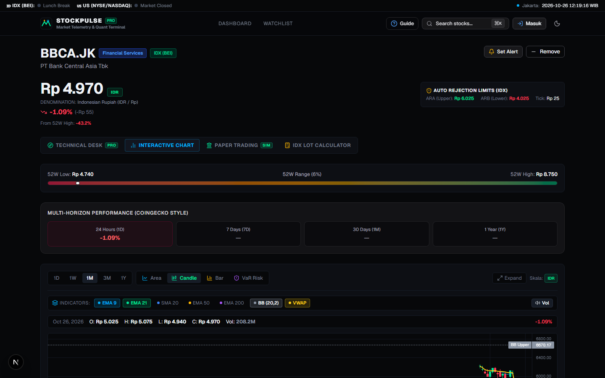
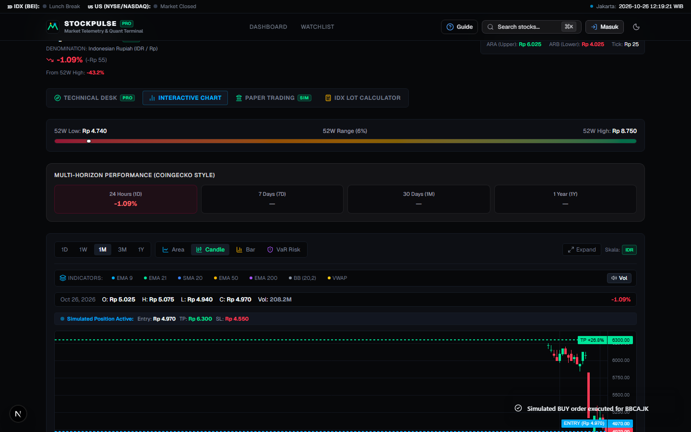
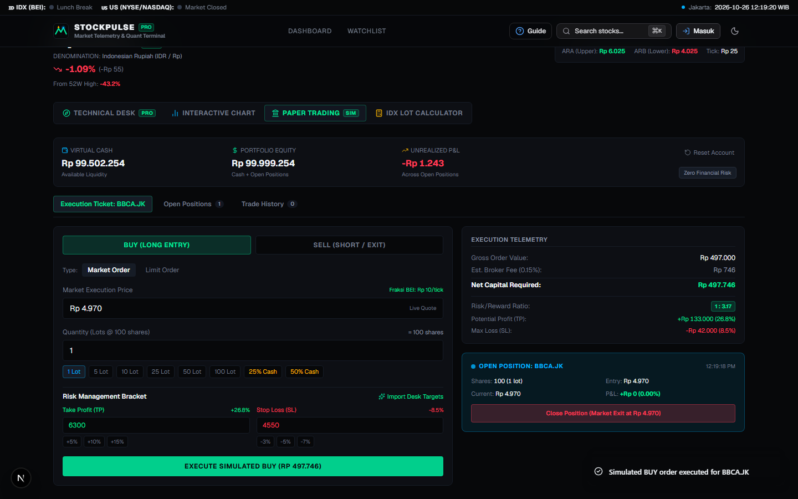
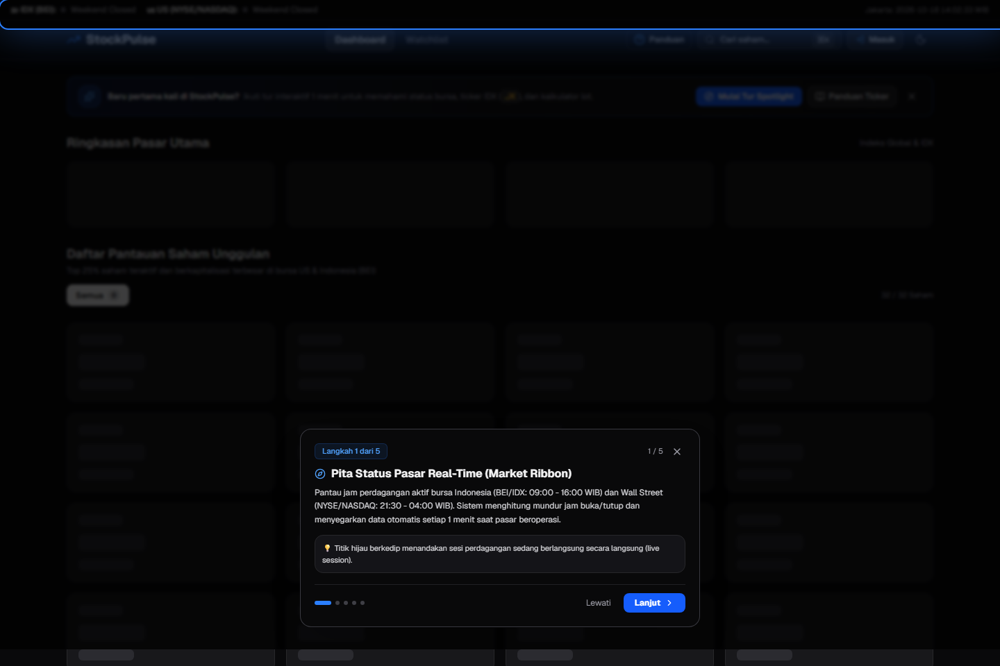
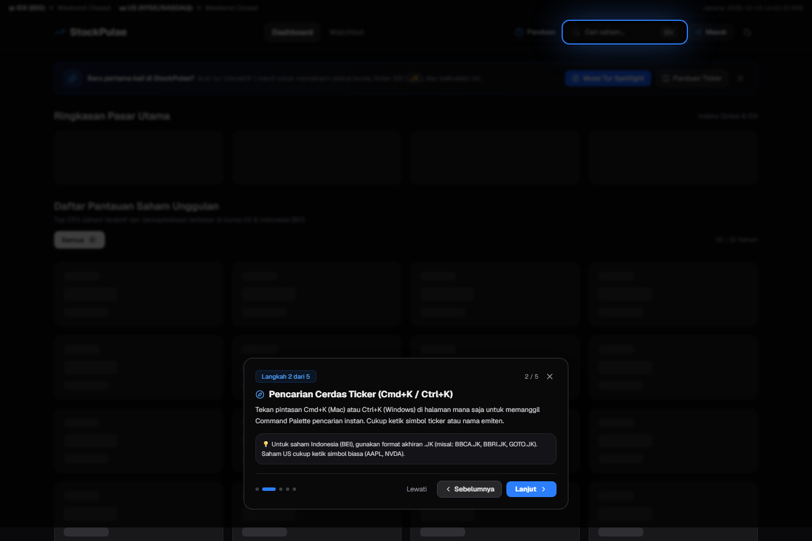
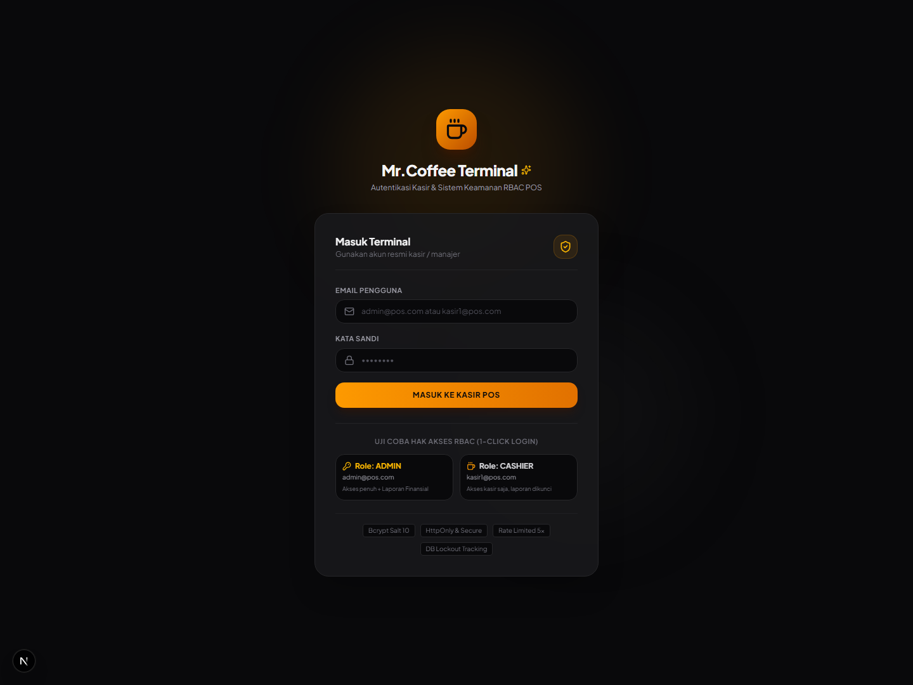

# 📈 StockPulse — Real-Time Equity & Quant Intelligence Terminal

<div align="center">

🌐 **Bahasa / Language:** **Bahasa Indonesia** | [English](./README.md)

</div>

> **StockPulse** adalah terminal intelijen pasar modal dan analisis kuantitatif real-time untuk bursa Amerika Serikat (US) dan Indonesia (IDX / BEI). Dibangun dengan sistem desain minimalis *Obsidian Vault* berstandar Awwwards, arsitektur serverless gratis (*100% free tier*), charting TradingView Lightweight Charts dengan *1-Click Technical Indicator Tray*, Paper Trading Simulator interaktif dengan *auto-snapping* Fraksi Harga resmi BEI, analitik *Stan Weinstein 4-Stage Technical Desk*, serta pemodelan dampak pasar *Almgren-Chriss*.

---

[-black?logo=next.js)](https://nextjs.org)
[](https://react.dev)
[](https://fastapi.tiangolo.com)
[](https://tailwindcss.com)
[](https://www.typescriptlang.org)
[](https://tradingview.github.io/lightweight-charts/)
[-green?logo=vitest)](https://vitest.dev)
[-green?logo=pytest)](https://pytest.org)
[](https://playwright.dev)
[](https://supabase.com)
[](https://stock-market-watcher-lemon.vercel.app)
[](#-ai-assisted-development)

---

## 📸 Bukti Tampilan Terbaru & Fitur Unggulan

Berikut adalah bukti tangkapan layar langsung (*live screenshot captures*) dari antarmuka StockPulse terbaru:

### 1. 🕯️ Technical Indicator Tray & Garis Proyeksi Harga (TradingView Canvas)
Charting interaktif dengan **Indicator Tray** 1-klik (**EMA 9**, **EMA 21**, **SMA 20**, **EMA 50**, **EMA 200**, **Bollinger Bands**, **VWAP**, **Volume**), mode kanvas bioskop (*theater mode*), serta garis harga horizontal dinamis untuk order simulasi aktif (**Entry**, **Take Profit**, **Stop Loss**).

| Indicator Tray & Candlestick Canvas | Dynamic Price Lines Overlay (TP / SL) |
| :---: | :---: |
|  |  |

---

### 2. 💼 Paper Trading Execution Desk & Telemetri Portofolio
Simulasi transaksi saham dengan pemantauan telemetri portofolio real-time, tiket order market & limit, penyesuaian fraksi harga BEI otomatis, impor target 1-klik dari Meja Teknikal, dan pemangkasan posisi (*position trimming*).



---

### 3. 🌟 Interactive Spotlight Tour & Onboarding
Panduan interaktif visual langsung di atas elemen DOM aktif via React Portal, dilengkapi *true cutout spotlight*, kartu popover mengambang, serta navigasi keyboard lengkap (<kbd>Esc</kbd>, <kbd>→</kbd>, <kbd>←</kbd>).

| Langkah 1: Pita Status Bursa Real-Time | Langkah 2: Command Palette Ticker Search |
| :---: | :---: |
|  |  |

---

### 4. 🔍 Pencarian Cepat Command Palette (<kbd>Cmd+K</kbd> / <kbd>Ctrl+K</kbd>)
Pencarian instan dengan navigasi keyboard, *autocomplete*, badge bursa, dan deteksi otomatis saham US vs IDX (.JK).



---

## ⚡ Fitur Utama

### 💼 1. Paper Trading Simulator Desk
Ekosistem simulasi eksekusi tanpa risiko finansial yang dirancang untuk menguji strategi trading dengan mekanika bursa riil:
- **Telemetri Akun Virtual**: Saldo awal **Rp 100.000.000** untuk saham Indonesia dan **$10.000** untuk saham US, memantau Ekuitas Portofolio, Kas Tersedia, *Unrealized P&L*, dan *Realized P&L*.
- **Tiket Eksekusi Order**: Mendukung **BUY (Long)** dan **SELL (Short / Exit)** dengan **Market Orders** dan **Limit Orders**.
- **Auto-Snapping Fraksi Harga BEI**: Harga order otomatis mematuhi aturan fraksi resmi Bursa Efek Indonesia (Rp 1, 2, 5, 10, 25/tick) dengan tombol navigasi `-1T` / `+1T`.
- **Alokasi Lot Cepat**: Pilihan lot instan (1, 5, 10, 25, 50, 100 Lot) dan persentase kas portofolio (`25% Cash`, `50% Cash`).
- **Bracket Manajemen Risiko**: Kontrol Take Profit (TP) dan Stop Loss (SL) dengan preset persentase cepat (+5%, +10%, +15% / -3%, -5%, -7%).
- **✨ Import Desk Targets**: Tombol 1-klik untuk otomatis mengimpor level optimal Target 1 dan Stop Loss langsung dari hasil analisis *Stan Weinstein Technical Desk*.
- **Position Trimming & Jaminan Short Selling**: Secara cerdas menangani penutupan posisi long, pemangkasan parsial (*partial sell*), dan pelepasan dana jaminan short selling dengan perhitungan fee broker (0.15% beli, 0.25% jual).
- **Persistensi Sisi Klien**: Menyimpan saldo portofolio, posisi aktif, dan riwayat transaksi lengkap di `localStorage` browser.

---

### 🕯️ 2. Charting Finansial Profesional & Quick Indicator Tray
Ditenagai engine HTML5 Canvas berkecepatan tinggi dari TradingView (`lightweight-charts` v5.2) dengan animasi super mulus tanpa beban DOM:
- **Mode Tampilan Grafik**:
  - **Candlestick (`Candle`)**: Sumbu dan badan lilin tajam dengan warna Neo-Emerald (`#00E599`) dan Crimson (`#FF3B56`).
  - **OHLC Bar (`Bar`)**: Tampilan batang klasik Wall Street/Bloomberg dengan tick buka di kiri dan tick tutup di kanan.
  - **Value at Risk Distribution (`VaR Risk`)**: Analisis risiko kuantitatif menghitung **1-Day 95% VaR**, **1-Day 99% Tail Risk**, **Conditional VaR (CVaR 95%)**, **Annualized Volatility**, serta histogram probabilitas return harian.
  - **Area Trend (`Area`)**: Kurva pergerakan harga halus dengan isian gradien linear adaptif.
- **Institutional Technical Indicator Tray**: Bar tombol toggle 1-klik dengan titik status berwarna langsung di atas canvas grafik:
  - **EMA 9** (Cyan `#00B2FF`): Pemicu momentum jangka pendek.
  - **EMA 21** (Neo-Emerald `#00E599`): Baseline swing trading.
  - **SMA 20** (Royal Blue `#3B82F6`): Indikator *mean reversion*.
  - **EMA 50** (Amber `#FFB800`): Garis tren institusional menengah.
  - **EMA 200** (Purple `#A855F7`): Garis pembatas makro *bull/bear*.
  - **Bollinger Bands (20, 2)**: Pita atas (*upper*), pita tengah SMA 20, dan pita bawah (*lower*).
  - **VWAP (Volume-Weighted Average Price)** (Gold `#FACC15`): Tolok ukur rata-rata tertimbang volume intraday.
  - **Volume Histogram**: Overlay histogram volume dengan kode warna pergerakan harga.
- **Garis Proyeksi Harga Dinamis**: Memproyeksikan garis putus-putus horizontal langsung ke canvas candlestick saat terdapat posisi simulasi aktif (`SIM ENTRY`, `SIM TP`, `SIM SL`).
- **Expanded Theater Canvas Mode**: Tombol 1-klik untuk memperluas tinggi canvas chart dari 340px menjadi 520px untuk kenyamanan analisis mendalam.

---

### 🏛️ 3. Institutional Technical Analysis Desk (Tab PRO)
Sistem intelijen teknikal kuantitatif berdasarkan metodologi trading institusional klasik:
- **Stan Weinstein 4-Stage Analysis**: Mengidentifikasi fase siklus pasar ke dalam **Stage 1 (Akumulasi / Dasar)**, **Stage 2 (Markup / Bull Run)**, **Stage 3 (Distribusi / Puncak)**, atau **Stage 4 (Kapitulasi / Downtrend)** dilengkapi arah bias dan persentase keyakinan.
- **Market Structure & Swing Pivots**: Mendeteksi higher highs / higher lows (HH-HL) vs lower highs / lower lows (LH-LL), level support & resistance dinamis terdekat, *drawdown* dari puncak 300 hari, serta keselarasan MA 20/50/200.
- **Volume Spread Analysis (VSA)**: Membaca jejak transaksi bandar/institusi meliputi rasio partisipasi volume naik/turun 20 hari, pengali lonjakan volume, *selling climax*, *stopping volume*, dan penyerapan pasokan (*absorption*).
- **Momentum Suite Terpadu**: Mengombinasikan RSI (14 periode), MACD (garis, sinyal, histogram), ADX 14 (*trend strength*), Stochastic Oscillator (%K, %D), dan Chaikin Money Flow (CMF 20 arus akumulasi/distribusi dana).
- **Proyeksi Skenario Probabilistik**: Menghitung probabilitas matematis untuk skenario **Bullish Breakout**, **Base Case Konsolidasi**, dan **Bearish Breakdown** lengkap dengan pemicu teknikal dan target harga.
- **Rencana Trading Institusional**: Rekomendasi aksi tegas (**Buy on Breakout**, **Buy on Weakness**, **Take Profit**, **Hold**, **Avoid**) dilengkapi zona beli, batas stop loss, target milestone 1 & 2, rasio Risk/Reward, dan batasan psikologis (*mindset guardrail*).

---

### 🇮🇩 4. Mekanika Khusus Pasar Indonesia (Bursa Efek Indonesia / IDX)
- **Kalkulator Lot BEI**: Simulasi transaksi saham presisi standar 1 lot = 100 lembar saham dengan opsi Beli/Jual, chip cepat (1, 5, 10, 50, 100 lot), estimasi fee broker (0.15% beli, 0.25% jual), levy bursa, dan PPh final.
- **Batas Auto Rejection Simetris (ARA & ARB)**: Kalkulasi batas kenaikan tertinggi (*Auto Rejection Atas*) dan penurunan terendah (*Auto Rejection Bawah*) berdasarkan fraksi harga resmi BEI.
- **Format Ticker Terstandarisasi**: Dukungan mulus suffix `.JK` untuk semua emiten BEI (misal: `BBCA.JK`, `BBRI.JK`, `TLKM.JK`, `GOTO.JK`).
- **Live WIB Ticking Clock**: Jam pasar real-time Jakarta berdetik setiap detik tanpa perlu refresh halaman.

---

### 🔬 5. Quantitative Finance & Algorithmic Execution Suite
- **Almgren-Chriss (2000) Optimal Execution Simulator**: Memodelkan dampak pasar non-linear ($I \propto \sigma \sqrt{\text{Order} / \text{ADV}}$) dan Biaya Riil Eksekusi (TCO) di dalam Kalkulator Lot BEI. Menyediakan profil urgensi interaktif (**Aggressive**, **Balanced**, **Passive TWAP**), analisis rasio partisipasi, dan jadwal eksekusi 4-tahap terencana.
- **Kalman Filter Dynamic Beta & Drift**: Menggantikan regresi CAPM statis dengan *State-Space 1D Kalman Filter* untuk mengestimasi koefisien beta dinamis ($\beta_t$), indeks pemisahan pasar ($1 - R^2$), dan status *drift* (`BETA_EXPANDING`, `BETA_DEFENSIVE`, `STABLE`).
- **Marchenko-Pastur Random Matrix Theory (RMT) Correlation Denoising**: Menghilangkan *noise* sampel empiris dari matriks korelasi portofolio dengan menyaring nilai eigen di bawah batas atas teoritis Marchenko-Pastur ($\lambda_+ = \sigma^2(1 + \sqrt{N/T})^2$).
- **Matriks Heatmap Korelasi Portofolio Interaktif**: Matriks korelasi langsung pada halaman Watchlist dengan toggle 1-klik antara tampilan Denoised (RMT) dan Empiris Mentah, penghitung diagnostik spektral, serta inspeksi hover sel.

---

### 🌟 6. Sistem Desain Minimalis Obsidian Vault & Onboarding
- **Estetika Kelas Awwwards**: Palet Obsidian Gelap (`#07080A`), kontainer monolitik (`#0D0F14`), garis tepi arsitektural hairline (`#161C26`), Neo-Emerald (`#00E599`), dan Crimson Laser (`#FF3B56`).
- **Identitas Brand**: Logo vektor geometris kustom *Dynamic Aperture Vector* dan favicon tab browser SVG multi-resolusi (`favicon.svg` & `icon.svg`).
- **5-Step Live Element Spotlight Tour**: Menyorot elemen nyata secara dinamis (`getBoundingClientRect()`) dengan transisi *smooth scroll*:
  1. `tour-market-status`: Jam perdagangan BEI (09:00 - 16:00 WIB) & Wall Street US (21:30 - 04:00 WIB).
  2. `tour-search-command`: Shortcut <kbd>Cmd+K</kbd> / <kbd>Ctrl+K</kbd> dan format suffix `.JK`.
  3. `tour-market-summary`: 4 indeks pasar utama (S&P 500, Nasdaq, Dow Jones, IHSG) & mini sparklines.
  4. `tour-sector-filter`: Filter instan bursa (US / IDX) dan sektor industri.
  5. `tour-stock-grid`: Kartu saham real-time, link chart, kalkulator lot, dan alert harga.

---

## 🛠️ Tech Stack

| Lapisan | Teknologi | Keterangan |
|---|---|---|
| **Frontend Framework** | **Next.js 16.3.8 (App Router)** | Fullstack React framework dengan bundler ultra-cepat Turbopack |
| **UI Library** | **React 19** & **Tailwind CSS v4** | Komponen modern dengan token tema minimalis Obsidian Vault |
| **Chart Engines** | **TradingView Lightweight Charts v5.2** & **Recharts v3** | Kanvas Candlestick, OHLC Bar, Area, Indicator Tray, dan sebaran VaR |
| **Simulasi Trading** | **Custom Paper Trading Engine** & **BEI Fraksi Snapper** | Portofolio virtual dengan eksekusi order, bracket TP/SL, dan sync localStorage |
| **Primitives & Icons** | **Radix UI**, **CMDK**, **Lucide React** | Dialog aksesibel, popover, command palette, dan ikon vektor |
| **State Management** | **TanStack Query v5** & **Zustand v5** | Server-state caching dan client store terpusat dengan persistensi `localStorage` |
| **Backend API** | **FastAPI (Python 3.12)** | REST API Python asinkron dengan validasi Pydantic v2 dan kalkulasi quant |
| **Data Provider** | **yfinance (Yahoo Finance)** + **cachetools** | Penyedia data pasar gratis dengan in-memory TTL caching |
| **Database & Auth** | **Supabase (PostgreSQL)** | Watchlist persisten, alert harga, dan schema siap-autentikasi |
| **Testing** | **Vitest** (90 tests), **Pytest** (57 tests), **Playwright** | 100% kelulusan tes di unit, service, dan otomasi browser E2E (147+ tes) |
| **Deployment** | [**Vercel Serverless**](https://stock-market-watcher-lemon.vercel.app) | Monorepo production deployment dengan serverless routing |

---

## 🚀 Panduan Memulai Cepat

### Prasyarat
- **Node.js** v20+ dan npm
- **Python** 3.12+

---

### 1. Clone Repository
```bash
git clone https://github.com/NAxel-code/stock-market-watcher.git
cd stock-market-watcher
```

---

### 2. Jalankan Backend (FastAPI)
```bash
cd backend

# Buat virtual environment
python -m venv venv

# Aktifkan virtual environment
# Windows:
.\venv\Scripts\activate
# macOS/Linux:
source venv/bin/activate

# Install dependensi
pip install -r requirements.txt

# Salin file environment
cp .env.example .env

# Jalankan server pengembangan
uvicorn app.main:app --reload --port 8000
```
- Backend API aktif di: `http://localhost:8000`
- Dokumentasi interaktif OpenAPI / Swagger: `http://localhost:8000/docs`

---

### 3. Jalankan Frontend (Next.js 16)
Buka tab terminal baru di root folder proyek:
```bash
cd frontend

# Install dependensi
npm install

# Salin file environment
cp .env.example .env.local

# Jalankan server pengembangan
npm run dev
```
- Buka browser di: `http://localhost:3000`

---

## 🧪 Pengujian Otomatis

Proyek ini menerapkan *Test-Driven Development (TDD)* yang ketat untuk menjamin keandalan kalkulasi matematika, series grafik, dan komponen UI.

### Pengujian Frontend Unit & Komponen (Vitest)
```bash
cd frontend
npm test
```
> **Hasil Uji Terbaru**: **90 / 90 tes lulus (100% LULUS)** di 18 test suite:
> - `PaperTradingDesk.test.tsx` (4 tes) - *Tiket order, impor target desk, toggle BUY/SELL*
> - `PriceChart.test.tsx` (5 tes) - *Candlestick, OHLC Bar, VaR Risk, Indicator Tray, Theater Mode*
> - `usePaperTradingStore.test.ts` (8 tes) - *Akuntansi order, fee, trimming posisi, jaminan short*
> - `indicators.test.ts` (4 tes) - *Kalkulasi EMA 9/21, SMA 20, Bollinger Bands, dan VWAP*
> - `formatters.test.ts` (12 tes) - *Tick size fraksi BEI, stepping harga, lot, dan mata uang*
> - `StockCard.test.tsx` (9 tes)
> - `AnalysisDeskTab.test.tsx` (3 tes)
> - `IdxLotCalculator.test.tsx` (3 tes)
> - `SpotlightTour.test.tsx` (5 tes)
> - `TutorialModal.test.tsx` (5 tes)
> - `DenoisedCorrelationHeatmap.test.tsx` (4 tes)
> - `MarketStatusRibbon.test.tsx` (1 tes)
> - `SectorFilterBar.test.tsx` (3 tes)
> - `FiftyTwoWeekRangeBar.test.tsx` (2 tes)
> - `MultiHorizonReturns.test.tsx` (2 tes)
> - `Sparkline.test.tsx` (4 tes)
> - `api.test.ts` (9 tes)
> - `useUIStore.test.ts` (7 tes)

### Pengujian Backend Unit & Service (Pytest)
```bash
cd backend
.\venv\Scripts\pytest -v
```
> **Hasil Uji Terbaru**: **57 / 57 tes lulus (100% LULUS)**:
> - `test_technical_desk.py` (12 tes) - *Analisis stage, VSA, CMF, momentum & skenario*
> - `test_api.py` (15 tes) - *Endpoints, penanganan error, batch & validasi*
> - `test_idx_rules.py` (9 tes) - *ARA/ARB, tick size & jam perdagangan BEI*
> - `test_yahoo_finance_service.py` (9 tes) - *Quote, histori & caching*
> - `test_schemas.py` (4 tes) - *Model data Pydantic*
> - `test_coingecko_features.py` (3 tes) - *Jarak 52 minggu & sparklines*
> - `test_alerts.py` (3 tes) - *Pemicu notifikasi harga*

### Otomasi Pengujian Browser E2E (Playwright)
```bash
python scripts/test_webapp_playwright.py
```
> **Hasil Uji Terbaru**: **5 / 5 tahap lulus**:
> 1. Pemuatan awal Dashboard dan telemetri jam WIB.
> 2. Navigasi halaman detail saham (`/stocks/BBCA.JK`).
> 3. Aktivasi Technical Indicator Tray (EMA 9, EMA 21, BB, VWAP).
> 4. Eksekusi simulasi order Paper Trading dan pengurangan kas portofolio.
> 5. Verifikasi garis harga horizontal di canvas grafik (`SIM ENTRY`, `SIM TP`, `SIM SL`).

---

## 📁 Struktur Monorepo

```
stock-market-watcher/
├── package.json               # Root monorepo npm workspaces
├── vercel.json                # Konfigurasi deployment Vercel & serverless proxy
├── docs/                      # PRD, diagram arsitektur, aset visual
│   └── screenshots/           # UI, indikator grafik, dan bukti eksekusi trading
├── frontend/                  # Next.js 16 App Router
│   ├── public/
│   │   ├── favicon.svg        # Favicon vektor Dynamic Aperture
│   │   └── icon.svg           # Ikon aplikasi PWA resolusi tinggi
│   ├── src/
│   │   ├── app/
│   │   │   ├── layout.tsx     # Root layout dengan dark mode & query client
│   │   │   ├── page.tsx       # Halaman dashboard utama
│   │   │   ├── stocks/[ticker]# Halaman analitik detail saham dinamis
│   │   │   └── watchlist/     # Halaman pengelola watchlist khusus
│   │   ├── components/
│   │   │   ├── features/      # PriceChart, PaperTradingDesk, AnalysisDeskTab, IdxLotCalculator, dll.
│   │   │   ├── layout/        # Navbar, MarketStatusRibbon, ThemeToggle
│   │   │   └── ui/            # StockPulseLogo, Button, Dialog, Badge, Skeleton
│   │   ├── hooks/             # Custom hook TanStack Query
│   │   ├── lib/               # indicators, formatters, api client, utilities
│   │   ├── stores/            # usePaperTradingStore, useUIStore
│   │   └── types/             # Interface TypeScript (StockQuote, Returns, StageInfo, dll.)
│   └── next.config.ts         # Konfigurasi Turbopack & API proxy rewrites
└── backend/                   # FastAPI Python backend
    ├── pyproject.toml         # Standar packaging PEP 621 (uv/hatchling)
    ├── app/
    │   ├── api/v1/            # Endpoints: stocks, market, watchlist, alerts
    │   ├── core/              # Konfigurasi aplikasi, exception, structured logging
    │   ├── models/            # Schema Pydantic (StockQuote, AnalysisDeskResponse, dll.)
    │   ├── services/          # Provider yfinance, kalkulasi meja teknikal, caching
    │   └── db/                # Migrasi Supabase PostgreSQL
    └── tests/                 # Test suite Pytest (57 tes)
```

---

## 📌 Riwayat Issue & Resolusi (GitHub Issues)

Semua peningkatan arsitektur dan perbaikan bug tercatat secara lengkap pada GitHub Issue Tracker repository:

| Issue | Judul & Cakupan | Label | Commit Penyelesaian |
| :---: | :--- | :--- | :--- |
| [**#1**](https://github.com/NAxel-code/stock-market-watcher/issues/1) | `feat(tutorial): Interactive Spotlight Tour with live DOM element highlighting` | `enhancement`, `accessibility` | [`9dd1236`](https://github.com/NAxel-code/stock-market-watcher/commit/9dd1236) |
| [**#2**](https://github.com/NAxel-code/stock-market-watcher/issues/2) | `feat(tutorial): Interactive feature guide and ticker cheat sheet modal` | `enhancement`, `documentation` | [`67936c5`](https://github.com/NAxel-code/stock-market-watcher/commit/67936c5) |
| [**#3**](https://github.com/NAxel-code/stock-market-watcher/issues/3) | `fix(currency): Market indices formatted as currency and USD/IDR inconsistency across views` | `bug` | [`628c04a`](https://github.com/NAxel-code/stock-market-watcher/commit/628c04a) |
| [**#4**](https://github.com/NAxel-code/stock-market-watcher/issues/4) | `refactor(ui): UI/UX audit for financial terminal aesthetic and contrast compliance` | `enhancement` | [`666d010`](https://github.com/NAxel-code/stock-market-watcher/commit/666d010) |
| [**#5**](https://github.com/NAxel-code/stock-market-watcher/issues/5) | `feat(watchlist): Sector and market filter explorer for US & IDX bluechip tickers` | `enhancement` | [`7c9e456`](https://github.com/NAxel-code/stock-market-watcher/commit/7c9e456) |
| [**#6**](https://github.com/NAxel-code/stock-market-watcher/issues/6) | `feat(analytics): 7-day sparklines, multi-horizon returns, and 52-week peak distance` | `enhancement` | [`cb16a4a`](https://github.com/NAxel-code/stock-market-watcher/commit/cb16a4a) |
| [**#7**](https://github.com/NAxel-code/stock-market-watcher/issues/7) | `fix(deploy): Vercel monorepo configuration, python uv packaging, and serverless routing` | `bug` | [`26788c2`](https://github.com/NAxel-code/stock-market-watcher/commit/26788c2) |
| [**#8**](https://github.com/NAxel-code/stock-market-watcher/issues/8) | `fix(nextjs16): Next.js 16 dynamic route params Promise and CommandDialog context wrap` | `bug` | [`36b919d`](https://github.com/NAxel-code/stock-market-watcher/commit/36b919d) |
| [**#9**](https://github.com/NAxel-code/stock-market-watcher/issues/9) | `feat(ui): Complete UI/UX redesign to Awwwards standards with minimalist Obsidian Vault theme, new vector logo & tab favicon` | `enhancement` | [`41ca752`](https://github.com/NAxel-code/stock-market-watcher/commit/41ca752) |
| [**#10**](https://github.com/NAxel-code/stock-market-watcher/issues/10) | `feat(trading): Paper Trading Simulator desk, institutional Indicator Tray, and IDX fraksi harga snapping` | `enhancement` | [`59bd86a`](https://github.com/NAxel-code/stock-market-watcher/commit/59bd86a) & [`42bc6e9`](https://github.com/NAxel-code/stock-market-watcher/commit/42bc6e9) |

---

## 🤖 AI-Assisted Development

Proyek ini dibangun menggunakan metode *AI-assisted pair programming* (Google DeepMind Antigravity) untuk perancangan arsitektur sistem, desain komponen antarmuka, dan pengujian berbasis tes (*Test-Driven Development*), dipandu oleh prinsip rekayasa perangkat lunak yang berfokus pada kode bersih, tanpa abstraksi spekulatif, dan presisi domain finansial.

---

## 📄 Lisensi

Didistribusikan di bawah Lisensi **MIT**. Lihat [LICENSE](./LICENSE) untuk informasi lengkap.
